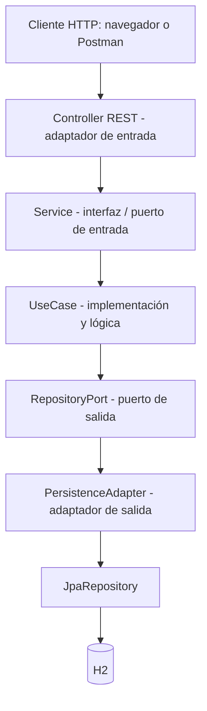

# AutoRent — Sistema de alquiler de autos

Proyecto de clase de **Programación Web Backend**, desarrollado en Java y Spring Boot. Permite registrar y editar autos y clientes, cambiar manualmente un auto a mantenimiento, crear alquileres, calcular el valor a pagar, consultar información y finalizar alquileres. Se organiza con **arquitectura hexagonal (puertos y adaptadores)** y almacena los datos en **H2**.

> **Integrantes:** completar con los nombres del grupo antes de entregar.  
> **Asignatura:** Programación Web Backend.  
> **Objetivo:** implementar las reglas de alquiler con arquitectura hexagonal y una API REST funcional.

## 1. Tecnologías utilizadas

| Tecnología | Uso en AutoRent |
|---|---|
| Java 17 | Lenguaje del proyecto |
| Spring Boot 4.1.1 | Inicio de la aplicación y configuración |
| Spring Web MVC | Endpoints REST (`GET`, `POST` y `PUT`) |
| Spring Data JPA | Guardar y consultar datos mediante repositorios |
| H2 | Base de datos en memoria |
| Maven Wrapper | Ejecutar, compilar y probar el proyecto |
| HTML, CSS y JavaScript | Interfaz para registrar, consultar y finalizar alquileres |

La versión de Spring Boot y las dependencias se encuentran en `pom.xml`.

## 2. Cómo ejecutar el proyecto

**Requisitos:** tener instalado un JDK compatible con Java 17 y conexión a Internet la primera vez que Maven deba descargar dependencias. H2 no necesita instalación aparte.

1. Descomprimir el ZIP.
2. Abrir una terminal **dentro de la carpeta `autorent`** (donde está `pom.xml`).
3. Iniciar el servidor:

**Windows (PowerShell o CMD):**

```bat
mvnw.cmd spring-boot:run
```

**Linux o macOS:**

```bash
./mvnw spring-boot:run
```

4. Cuando Spring Boot haya iniciado, visitar:

| Dirección | Uso |
|---|---|
| `http://localhost:7777/` | Interfaz del proyecto |
| `http://localhost:7777/api/autos` | Lista de vehículos |
| `http://localhost:7777/h2-console` | Consola de la base de datos |

El puerto está configurado en `src/main/resources/application.properties` (`server.port=7777`). Para detener el servidor, usar `Ctrl+C`.

### Base de datos H2

En `http://localhost:7777/h2-console`, utilizar estos datos:

| Configuración | Valor |
|---|---|
| JDBC URL | `jdbc:h2:mem:autorent` |
| User Name | `sa` |
| Password | dejar vacío |

Después de conectarse, se pueden ejecutar estas consultas:

```sql
SELECT * FROM AUTO_ENTITY;
SELECT * FROM CLIENTE_ENTITY;
SELECT * FROM ALQUILER_ENTITY;
```

**Importante:** H2 está configurada **en memoria** y `ddl-auto=create-drop`: al reiniciar el servidor se pierde lo creado durante la sesión. `data.sql` inserta clientes y autos de ejemplo cada vez que arranca. En esos datos, los autos **5 y 8** aparecen `ALQUILADO`, pero no hay alquileres precargados para finalizarlos; el auto **3** está en `MANTENIMIENTO`.

## 3. Funciones y reglas de negocio

El proyecto maneja tres entidades:

- **Auto:** `id`, `placa`, `marca`, `modelo`, `anio`, `precioPorDia`, `deposito` y `estado` (`DISPONIBLE`, `ALQUILADO`, `MANTENIMIENTO`).
- **Cliente:** `id`, `nombre`, `documento`, `telefono` y `email`.
- **Alquiler:** `id`, `clienteId`, `autoId`, `fechaInicio`, `fechaFin`, `cantidadDias`, `valorTotal` y `estado` (`ACTIVO`, `FINALIZADO`).

Reglas que aplica el backend:

1. Un auto solo puede alquilarse si está **DISPONIBLE**; no se admiten autos `ALQUILADO` ni `MANTENIMIENTO`.
2. Al crear el alquiler, el auto cambia a **ALQUILADO** y el alquiler nace **ACTIVO**.
3. Al finalizar, el alquiler pasa a **FINALIZADO** y el auto vuelve a **DISPONIBLE**.
4. No se permite finalizar un alquiler dos veces.
5. `cantidadDias` debe ser mayor que cero.
6. `valorTotal` se calcula en el backend: **precioPorDia × cantidadDias**. No se envía en el POST.
7. El cliente y el auto deben existir antes de crear un alquiler.
8. Para registrar un auto se exige placa, marca, modelo, año válido y precio positivo. Todo auto nuevo se registra como `DISPONIBLE`.
9. Para registrar un cliente se exige nombre, documento y email válido.
10. **Datos únicos:** la `placa` (autos) y el `documento` y el `email` (clientes) no se pueden repetir, **ni al registrar ni al editar**. Al editar se ignora el propio registro, de modo que se puede guardar sin cambiar esos datos. La placa y el email se comparan sin distinguir mayúsculas.
11. **Cambio manual de estado:** un auto puede pasar de `DISPONIBLE` a `MANTENIMIENTO` y volver. Un auto `ALQUILADO` solo cambia al finalizar su alquiler, y ningún auto se puede marcar como `ALQUILADO` a mano.
12. **Edición de autos:** no se puede editar un auto `ALQUILADO`. La edición nunca cambia el estado (cualquier `estado` enviado en el JSON se ignora).
13. **Edición de clientes:** no se puede editar un cliente que tenga un alquiler `ACTIVO`.

Al crear un alquiler, el servicio usa `LocalDate.now()` para la fecha de inicio y suma los días solicitados para la fecha de fin.

## 4. Arquitectura hexagonal explicada de forma sencilla

La arquitectura hexagonal evita que las reglas del negocio dependan directamente de la base de datos o de los controladores web. Por eso el proyecto separa **dominio**, **aplicación** e **infraestructura**.



> El dibujo representa el camino principal de almacenamiento; una operación puede realizar varias consultas y guardados antes de responder.

| Carpeta / clase | Responsabilidad |
|---|---|
| `domain/model` | Objetos de negocio (`Auto`, `Cliente`, `Alquiler`), independientes de JPA |
| `domain/exception` | Errores específicos del negocio |
| `application/port/input` | Interfaces `AutoService`, `ClienteService` y `AlquilerService`: definen **qué acciones** permite el sistema |
| `application/usecase` | Clases concretas que implementan las interfaces Service y ejecutan la lógica |
| `application/port/output` | Interfaces que indican **qué necesita guardar o consultar** el caso de uso |
| `infrastructure/adapter/input/rest` | Controllers que reciben las peticiones HTTP |
| `infrastructure/adapter/output/persistence/adapter` | Adaptadores que convierten modelos de dominio a entidades JPA y viceversa |
| `infrastructure/adapter/output/persistence/entity` | Clases que JPA relaciona con las tablas |
| `infrastructure/adapter/output/persistence/repository` | Interfaces `JpaRepository` usadas para acceder a H2 |
| `infrastructure/config` | Configuración de los casos de uso y sus dependencias |
| `src/main/resources/static/index.html` | Pantalla para interactuar con los endpoints |

**Diferencias que debes poder explicar:**

- **Puerto:** interfaz Java. Define una operación sin especificar cómo se ejecuta. Ejemplo: `AutoRepositoryPort`.
- **Adaptador:** clase que conecta el puerto con una tecnología. Ejemplo: `AutoPersistenceAdapter` utiliza `AutoJpaRepository`.
- **Dominio:** describe los objetos y conceptos de alquiler, sin importar si los datos se guardan en H2 o en otra base de datos.
- **Service (interfaz):** declara las operaciones; no guarda lógica. Es el puerto de entrada que utiliza el Controller.
- **UseCase (clase):** implementa esa interfaz, valida y coordina las operaciones del negocio.
- **Controller:** recibe JSON o parámetros HTTP y delega en el caso de uso; no guarda directamente mediante `JpaRepository`.

### 4.1. Relación con el diagrama de clase

La imagen tradicional muestra `Controller → Service (interfaz) → ServiceImpl → JPA`. En este proyecto usamos nombres más adecuados para identificar el trabajo del código:

- `AutoService`, `ClienteService`, `AlquilerService`: **interfaces** (puertos de entrada).
- `AutoUseCase`, `ClienteUseCase`, `AlquilerUseCase`: **clases que implementan las interfaces** y contienen las reglas del negocio.
- `AutoRepositoryPort`, `ClienteRepositoryPort`, `AlquilerRepositoryPort`: **interfaces de salida**. El UseCase no utiliza `JpaRepository` directamente.
- `*PersistenceAdapter`: implementan los puertos de salida y se conectan a Spring Data JPA y H2.

Así se evita la dependencia directa `UseCase → JpaRepository`, que no sería fiel a la arquitectura hexagonal pedida. Los controladores trabajan solo con las interfaces `*Service`, nunca con las clases `*UseCase`.

**Nota sobre los nombres del enunciado:** el PDF utiliza como ejemplo `CrearAlquilerUseCase` como **interfaz** y `AlquilerService` como **implementación**. Aquí invertimos esos nombres por la organización solicitada, pero conservamos la función de puertos de entrada y lógica de aplicación, sin alterar las operaciones REST.

## 5. Endpoints disponibles

| Método | Ruta | Resultado esperado |
|---|---|---|
| `POST` | `/api/autos` | Registrar auto como `DISPONIBLE` — HTTP `201` |
| `PUT` | `/api/autos/{id}` | Editar datos del auto (no cambia el estado) — HTTP `200` |
| `PUT` | `/api/autos/{id}/estado` | Cambiar manualmente a `MANTENIMIENTO` o `DISPONIBLE` — HTTP `200` |
| `GET` | `/api/autos` | Listar todos los autos — HTTP `200` |
| `GET` | `/api/autos/{id}` | Consultar auto — HTTP `200` o `404` |
| `GET` | `/api/autos/disponibles` | Consultar autos disponibles — HTTP `200` |
| `POST` | `/api/clientes` | Registrar cliente — HTTP `201` |
| `PUT` | `/api/clientes/{id}` | Editar cliente (sin alquiler `ACTIVO`) — HTTP `200` |
| `GET` | `/api/clientes/{id}` | Consultar cliente — HTTP `200` o `404` |
| `POST` | `/api/alquileres` | Crear alquiler — HTTP `201` |
| `GET` | `/api/alquileres/{id}` | Consultar alquiler — HTTP `200` o `404` |
| `PUT` | `/api/alquileres/{id}/finalizar` | Finalizar alquiler — HTTP `200` |

En los POST, usar la cabecera `Content-Type: application/json` y seleccionar **Body → raw → JSON** en Postman.

### 5.1. Registrar un auto

**POST** `http://localhost:7777/api/autos`

```json
{
  "placa": "ABC123",
  "marca": "Toyota",
  "modelo": "Corolla",
  "anio": 2025,
  "precioPorDia": 150000
}
```

Si la placa ya existe, la respuesta es **409 Conflict**. Si se registra correctamente, se obtiene HTTP **201 Created**, con un objeto que incluye un `id` generado, `estado: "DISPONIBLE"` y `deposito: 300000.0` (valor predeterminado si no se envía). También puedes proporcionar `deposito` en el JSON.

### 5.2. Registrar un cliente

**POST** `http://localhost:7777/api/clientes`

```json
{
  "nombre": "Laura Pérez",
  "documento": "1000000999",
  "telefono": "3001234567",
  "email": "laura@example.com"
}
```

Se obtiene HTTP **201 Created** y el cliente registrado con su `id`. Si el documento o el email ya existen, la respuesta es **409 Conflict**.

### 5.3. Crear un alquiler

Se puede probar inmediatamente con los datos iniciales de `data.sql`: cliente **1** y auto **1**.

**POST** `http://localhost:7777/api/alquileres`

```json
{
  "clienteId": 1,
  "autoId": 1,
  "cantidadDias": 5
}
```

Ejemplo de **respuesta 201 Created** (las fechas y el identificador dependen de la ejecución):

```json
{
  "id": 1,
  "clienteId": 1,
  "autoId": 1,
  "fechaInicio": "2026-10-22",
  "fechaFin": "2026-10-27",
  "cantidadDias": 5,
  "valorTotal": 750000.0,
  "estado": "ACTIVO"
}
```

Las fechas son **ilustrativas**, no son fechas fijas del programa. Se calcula `150000 × 5 = 750000`, y el auto cambia a `ALQUILADO`. Puedes verificarlo con **GET** `http://localhost:7777/api/autos/1`.

### 5.4. Finalizar un alquiler

**PUT** `http://localhost:7777/api/alquileres/1/finalizar`

Reemplaza `1` por el ID que devolvió el POST. No necesita cuerpo JSON. La respuesta HTTP **200** devuelve el alquiler con `estado: "FINALIZADO"`, y el auto vuelve a estar `DISPONIBLE`.

### 5.5. Editar un auto

**PUT** `http://localhost:7777/api/autos/1`

```json
{
  "placa": "TOY125",
  "marca": "Toyota",
  "modelo": "Corolla XLI",
  "anio": 2025,
  "precioPorDia": 160000
}
```

Devuelve HTTP **200** con el auto actualizado y el mismo `estado` que tenía. Si el auto está `ALQUILADO`, responde **409**; si la placa pertenece a otro auto, **409**; si el auto no existe, **404**.

### 5.6. Cambiar el estado de un auto manualmente

**PUT** `http://localhost:7777/api/autos/1/estado`

```json
{
  "estado": "MANTENIMIENTO"
}
```

Para volver a dejarlo disponible, enviar `"estado": "DISPONIBLE"`. Solo se permiten esos dos valores: enviar `ALQUILADO` o intentar cambiar un auto que ya está `ALQUILADO` responde **409**; un valor que no existe responde **400**.

### 5.7. Editar un cliente

**PUT** `http://localhost:7777/api/clientes/1`

```json
{
  "nombre": "Carlos Pérez Gómez",
  "documento": "123456789",
  "telefono": "3001234567",
  "email": "carlos@email.com"
}
```

Devuelve HTTP **200** con el cliente actualizado. Si el cliente tiene un alquiler `ACTIVO`, responde **409**; si el documento o el email pertenecen a otro cliente, **409**; si el cliente no existe, **404**.

## 6. Validaciones y errores HTTP

| Situación | Respuesta | Ejemplo para comprobarla |
|---|---|---|
| Datos inválidos | `400 Bad Request` | `cantidadDias: 0` o email incorrecto |
| Cliente o auto inexistente en un alquiler | `404 Not Found` | `clienteId: 99999` |
| Auto no disponible | `409 Conflict` | Crear dos alquileres seguidos para el mismo auto |
| Placa, documento o email repetidos (al registrar o editar) | `409 Conflict` | Volver a registrar el mismo documento, email o placa |
| Editar un auto `ALQUILADO` | `409 Conflict` | `PUT /api/autos/5` (auto 5 de `data.sql`) |
| Marcar un auto como `ALQUILADO` a mano, o cambiar el estado de uno `ALQUILADO` | `409 Conflict` | `PUT /api/autos/1/estado` con `"estado": "ALQUILADO"` |
| Editar un cliente con alquiler `ACTIVO` | `409 Conflict` | Crear un alquiler para el cliente 1 y luego `PUT /api/clientes/1` |
| Auto o cliente inexistente al editar | `404 Not Found` | `PUT /api/autos/99999` |
| Alquiler ya finalizado | `409 Conflict` | Repetir el PUT de finalización |
| Alquiler inexistente al finalizar | `404 Not Found` | `PUT /api/alquileres/99999/finalizar` |

Los errores de operaciones de escritura son gestionados por `GlobalExceptionHandler`. Por ejemplo:

```json
{
  "error": "El alquiler ya se encuentra finalizado."
}
```

En cambio, los GET por ID del proyecto pueden responder **404 sin cuerpo JSON**, porque utilizan `ResponseEntity.notFound()`.

## 7. Pruebas y evidencias para la entrega

Ejecutar pruebas automáticas desde `autorent`:

```bat
mvnw.cmd test
```

Hay pruebas de casos de uso en `src/test/java`: comprueban cálculos, cambios de estado, errores de validación y las reglas de datos únicos, edición de autos y clientes y cambio manual de estado (`ReglasNegocioUseCaseTest`). También es necesario probar la API real en Postman o en el navegador.

Lista recomendada de **evidencias con capturas reales** (en este orden):

- [ ] Arranque correcto del servidor en la terminal.
- [ ] Creación de auto y consulta por ID.
- [ ] Creación de cliente y consulta por ID.
- [ ] Creación de alquiler y cálculo automático del total.
- [ ] Consulta del auto para verificar que cambió a `ALQUILADO`.
- [ ] Segundo intento de alquiler del mismo auto: HTTP `409`.
- [ ] Finalización de alquiler y auto de nuevo `DISPONIBLE`.
- [ ] Segundo intento de finalizar: HTTP `409`.
- [ ] Ejemplo de HTTP `400` por días inválidos.
- [ ] Registro de una placa o un email repetido: HTTP `409`.
- [ ] Cambio de un auto a `MANTENIMIENTO` y de regreso a `DISPONIBLE`.
- [ ] Intento de editar un auto `ALQUILADO` y un cliente con alquiler `ACTIVO`: HTTP `409`.
- [ ] Consulta de tablas desde la consola H2.
- [ ] Diagrama hexagonal de este README y explicación de sus capas.

El enunciado del profesor solicita entregar **código fuente, configuración funcional de H2, README, evidencias y diagrama de arquitectura**. El diagrama está incluido en este archivo mediante Mermaid (se visualiza en visores Markdown compatibles); si se pide como imagen independiente, se puede exportar a partir de él.

## 8. Notas importantes

- La aplicación es un **proyecto educativo**, no un sistema de alquiler listo para producción.
- Para comprobar la lógica utiliza también Postman y la consola de H2.
- Los importes permanecen como `Double` para seguir el nivel y el código original. Una aplicación financiera real suele utilizar `BigDecimal`.
- `@Transactional` ayuda a mantener juntos los cambios de una operación, pero por sí solo **no resuelve alquileres simultáneos del mismo auto** desde dos peticiones concurrentes.
- Si el navegador no responde, revisa que Spring Boot siga ejecutándose y que estés utilizando el **puerto 7777**.
- No modifiques manualmente el `valorTotal` en la petición de crear alquiler: el backend debe calcularlo.
